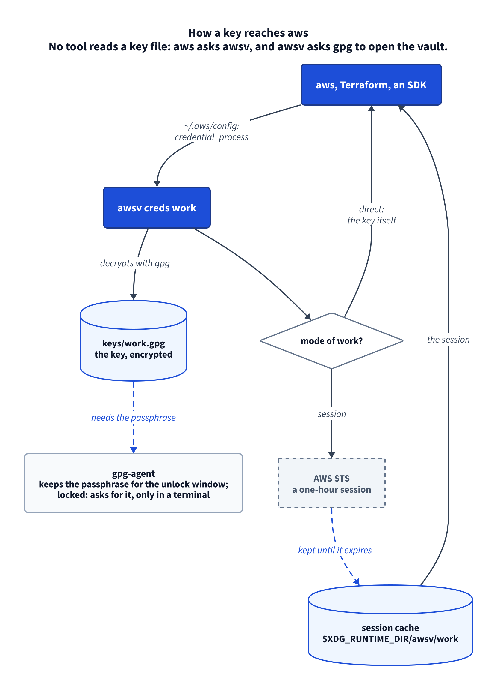
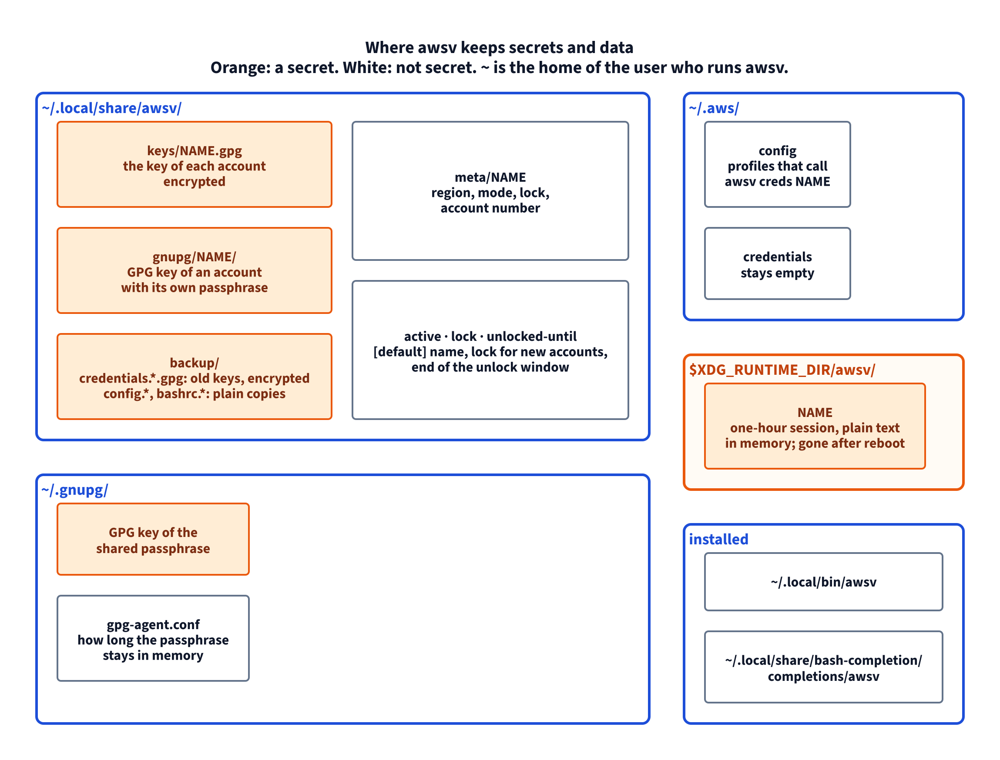

# awsv

awsv хранит ключи доступа AWS в зашифрованном сейфе, а не в открытом файле
`~/.aws/credentials`. `aws`, Terraform и AWS SDK работают как раньше. Пароль
вводится в начале работы: один на все аккаунты или свой для каждого.

[](docs/diagrams/flow.png)

## Установка

Нужны Linux, bash 4+, GnuPG 2.2+ с `pinentry-curses`, AWS CLI v2 и базовые
утилиты GNU.

```bash
git clone https://github.com/vadbosh/awsv.git
cd awsv
./install.sh            # проверит, всё ли есть, и установит awsv в ~/.local/bin
```

| Параметр установщика | Что делает |
|---|---|
| `./install.sh --check` | только проверяет, ничего не меняет |
| `./install.sh --dry-run` | проверяет и говорит, что записал бы |
| `./install.sh --uninstall` | удаляет команду и автодополнение; сейф остаётся |
| `./install.sh --uninstall --force` | то же, даже если `~/.aws/config` ещё обращается к awsv |
| `PREFIX=/opt/bin ./install.sh` | ставит в другой каталог |

Ещё установщик добавляет автодополнение для bash: в новом терминале Tab после
awsv подсказывает команды, имена аккаунтов и значения параметров.

## Быстрый старт

Ключи уже лежат в `~/.aws/credentials`:

```bash
awsv init --take-default         # выберите: один пароль на все аккаунты или свой у каждого
awsv import default --as work    # перенести секцию [default] в сейф под именем work
awsv import client               # перенести секцию [client]
awsv status                      # повторять import, пока не появится "no keys left"
```

Ключей ещё нет:

```bash
awsv init                              # выберите пароль
awsv add work --region eu-central-1    # введите id ключа, затем секрет (он не отображается)
aws sts get-caller-identity            # работает: ключ берётся из сейфа
```

После `init` откройте новый терминал: init добавляет в `~/.bashrc` строку
`export GPG_TTY=$(tty)`, без неё gpg не сможет спросить пароль.

## Команды

`NAME` — имя аккаунта, например `work`. `SECTION` — секция `~/.aws/credentials`.
`REGION` — регион AWS, например `eu-central-1`. `awsv help COMMAND` показывает
то же для одной команды.

### init — подготовить сейф, один раз

```bash
awsv init                    # спросит: 1 — один пароль на все аккаунты, 2 — свой у каждого
awsv init --lock shared      # ответ заранее: один пароль на все
awsv init --lock own         # ответ заранее: каждый новый аккаунт получит свой
awsv init --take-default     # в ~/.aws/config есть свой [default]: закомментировать его
```

Если сейф уже есть, `--lock` меняет только то, что получат новые аккаунты.

### add — добавить аккаунт

```bash
awsv add work                          # us-east-1, режим session, замок, который сейф даёт новым аккаунтам
awsv add prod --region eu-central-1    # другой регион
awsv add prod --mode direct            # программы получат сам ключ, а не сессию
awsv add prod --lock own               # у prod будет свой пароль
awsv add prod --lock shared            # prod на общем пароле
awsv add prod --no-verify              # сохранить, не спрашивая AWS, рабочий ли ключ
printf '%s\n%s\n' "$KEY_ID" "$SECRET" | awsv add ci --stdin   # id ключа и секрет со stdin
```

Без `--stdin` add читает ключ из терминала и не показывает секрет.

### import — перенести ключ из `~/.aws/credentials`

```bash
awsv import client                   # секция [client] или закомментированная #[client]
awsv import default --as work        # имя "default" занято: дайте аккаунту своё
awsv import client --keep            # оставить секцию в ~/.aws/credentials
awsv import client --region eu-west-1 --mode direct --lock own
awsv import client --no-verify       # не спрашивать AWS, рабочий ли ключ
```

Секция удаляется из файла; зашифрованная копия файла уходит в `backup/`.

### ls — список аккаунтов

```bash
awsv ls       # * — это [default]; дальше режим, замок, регион, номер аккаунта
```

### use — сменить аккаунт [default]

```bash
awsv use client      # теперь простой "aws ..." работает от client
```

### exec — одна команда от другого аккаунта

```bash
awsv exec client -- terraform plan    # [default] не меняется
aws --profile client s3 ls            # то же для одного aws
```

### set — сменить регион, режим или пароль

```bash
awsv set client --region us-east-2
awsv set client --mode direct        # программы получат сам ключ; для Terraform
awsv set client --mode session       # программы получат сессию на час (по умолчанию)
awsv set client --lock own           # спросит текущий пароль, затем новый
awsv set client --lock shared        # вернуть на общий пароль
```

### rekey — заменить ключ аккаунта

```bash
awsv rekey work                                              # введите новый ключ из IAM
printf '%s\n%s\n' "$KEY_ID" "$SECRET" | awsv rekey work --stdin
awsv rekey work --no-verify                                  # не спрашивать AWS заранее
```

Затем отключите старый ключ в IAM: AWS его всё ещё принимает.

### rm — удалить аккаунт

```bash
awsv rm old          # спросит подтверждение
awsv rm old --yes    # без вопроса
```

Затем отключите ключ в IAM. Удаление из сейфа его не отзывает.

### show — показать сохранённый ключ

```bash
awsv show work       # id ключа и секрет; только в своём терминале
```

### passwd — сменить пароль

```bash
awsv passwd          # общий пароль
awsv passwd prod     # пароль, который открывает prod
```

### unlock — открыть на выбранное время

```bash
awsv unlock              # пароль аккаунта [default], на 8 часов
awsv unlock 30m          # на 30 минут
awsv unlock 1h30m        # часы и минуты, до 24h
awsv unlock prod 30m     # пароль, который открывает prod
awsv unlock all 8h       # все пароли, по очереди
```

В своём терминале unlock не обязателен: первая команда `aws` в запертом
аккаунте сама спросит пароль. Cron, скрипты и ИИ-ассистенты спросить не могут —
откройте для них аккаунт заранее.

### lock — закрыть сейчас

```bash
awsv lock            # все пароли и все закэшированные сессии
awsv lock prod       # только пароль, который открывает prod
```

### status — проверить всё

```bash
awsv status          # сейф, каждый аккаунт, что открыто, остались ли ключи в ~/.aws/credentials
```

### Переменные окружения

| Переменная | По умолчанию | Что меняет |
|---|---|---|
| `AWSV_HOME` | `~/.local/share/awsv` | где лежит сейф |
| `AWSV_RUN` | `$XDG_RUNTIME_DIR/awsv`; для root без неё — `/run/awsv` | где кэшируются сессии; пустое значение отключает кэш |
| `AWSV_SESSION_SECONDS` | `3600` | сколько живёт сессия |
| `AWS_CONFIG_FILE`, `AWS_SHARED_CREDENTIALS_FILE` | `~/.aws/config`, `~/.aws/credentials` | какие файлы AWS awsv читает и пишет |
| `NO_COLOR` | не задана | если задана, вывод без цвета |

## Где лежат секреты и данные

[](docs/diagrams/storage.png)

| Путь | Что там | Секрет |
|---|---|---|
| `~/.local/share/awsv/keys/NAME.gpg` | ключ одного аккаунта, зашифрован | да, зашифрован |
| `~/.local/share/awsv/gnupg/NAME/` | ключ GPG аккаунта со своим паролем | да, под паролем |
| `~/.local/share/awsv/backup/` | `credentials.*.gpg` (старые ключи, зашифрованы); открытые копии `config` и `.bashrc` | да, зашифрован |
| `~/.local/share/awsv/meta/NAME` | регион, режим, замок, номер аккаунта | нет |
| `~/.local/share/awsv/active`, `lock`, `unlocked-until` | имя `[default]`, замок для новых аккаунтов, конец окна открытия | нет |
| `~/.gnupg/` | ключ GPG общего пароля; `gpg-agent.conf` | ключ — да, под паролем |
| `~/.aws/config` | профили, которые вызывают `awsv creds NAME`, между двумя строками-маркерами | нет |
| `~/.aws/credentials` | ничего: файл остаётся пустым | нет |
| `$XDG_RUNTIME_DIR/awsv/NAME` | сессия на час, открытым текстом, в памяти | да, пока не истечёт |

## От чего сейф не защищает

Пока аккаунт открыт, любой процесс того же пользователя может прочитать его ключ,
и никто не спросит разрешения. Это касается скриптов, заданий cron и
ИИ-ассистента, который работает от его имени. Держите аккаунт открытым
столько, сколько нужно (`awsv unlock 30m`), и закрывайте после работы
(`awsv lock`).

В режиме session уже выданная сессия работает, пока не истечёт, — до часа, даже
если окно открытия закончилось. `awsv lock` удаляет её сразу.

Подробнее: [docs/details.ru.md](docs/details.ru.md) — как это работает, один
пароль или свой у каждого аккаунта, режимы session и direct, ловушки,
восстановление, сообщения об ошибках, тесты.

## Лицензия

[MIT](LICENSE)
