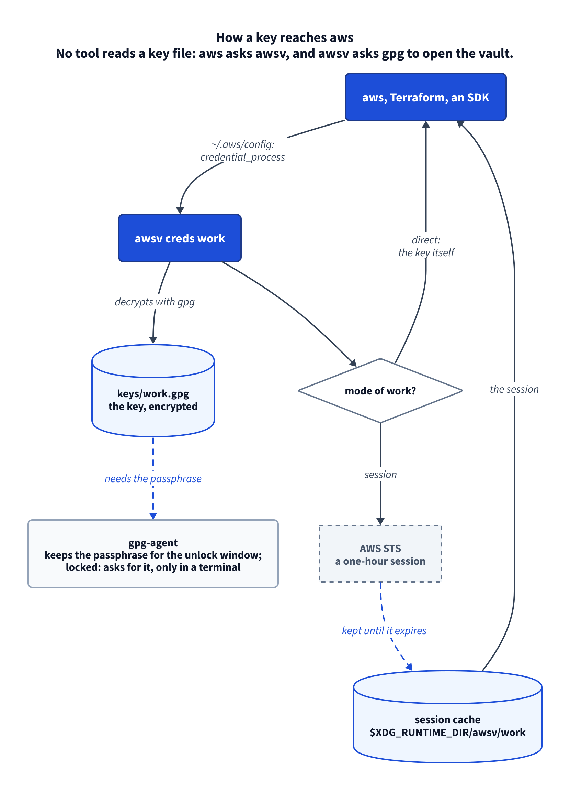
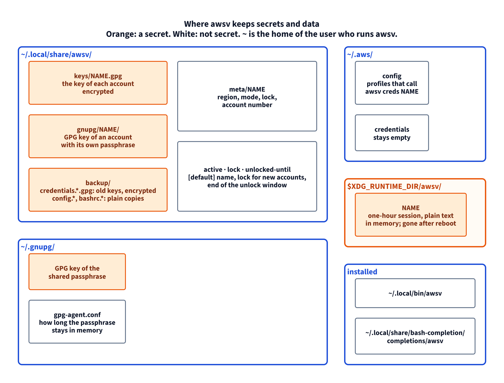

# awsv

awsv keeps your AWS access keys in an encrypted vault instead of the plain text
file `~/.aws/credentials`. `aws`, Terraform and the AWS SDKs work as before. You
type a passphrase when you start work: one for every account, or a separate one
for each account.

[](docs/diagrams/flow.png)

## Install

Needs Linux, bash 4+, GnuPG 2.2+ with `pinentry-curses`, AWS CLI v2 and the GNU
core tools.

```bash
git clone https://github.com/vadbosh/awsv.git
cd awsv
./install.sh            # checks what is needed, then installs both commands into ~/.local/bin
```

| Installer option | What it does |
|---|---|
| `./install.sh --check` | checks the components, changes nothing |
| `./install.sh --dry-run` | checks, then says what it would write |
| `./install.sh --uninstall` | removes both commands and the Tab completion; the vault stays |
| `./install.sh --uninstall --force` | the same while `~/.aws/config` still uses awsv |
| `PREFIX=/opt/bin ./install.sh` | installs into another directory |

The installer also adds Tab completion for bash: in a new terminal, Tab after
awsv offers the commands, the account names and the option values. Tab after
awsv-sso offers its commands, the SSO profiles and the regions.

## Quick start

You already have keys in `~/.aws/credentials`:

```bash
awsv init --take-default         # choose: one passphrase for all accounts, or one for each
awsv import default --as work    # move the [default] section into the vault, name it work
awsv import client               # move the section [client]
awsv status                      # repeat import until it says "no keys left"
```

You start with no keys:

```bash
awsv init                              # choose the passphrase
awsv add work --region eu-central-1    # type the key id, then the secret (it is not shown)
aws sts get-caller-identity            # works: the key comes from the vault
```

Open a new terminal after `init`: it adds `export GPG_TTY=$(tty)` to `~/.bashrc`,
and gpg needs it to ask for the passphrase.

## Commands

`NAME` is an account name such as `work`. `SECTION` is a section of
`~/.aws/credentials`. `REGION` is an AWS region such as `eu-central-1`.
`awsv help COMMAND` shows the same for one command.

### init — set up the vault, once

```bash
awsv init                    # asks: 1 one passphrase for all accounts, 2 one per account
awsv init --lock shared      # answer in advance: one passphrase for all
awsv init --lock own         # answer in advance: each new account gets its own
awsv init --take-default     # ~/.aws/config has its own [default]: comment it out
```

On a vault that exists, `--lock` changes only what new accounts get.

### add — store a new account

```bash
awsv add work                          # us-east-1, session mode, the lock the vault gives new accounts
awsv add prod --region eu-central-1    # another region
awsv add prod --mode direct            # tools get the key itself, not a session
awsv add prod --lock own               # prod gets a passphrase of its own
awsv add prod --lock shared            # prod takes the shared passphrase
awsv add prod --no-verify              # store without asking AWS if the key works
printf '%s\n%s\n' "$KEY_ID" "$SECRET" | awsv add ci --stdin   # key id and secret from stdin
```

Without `--stdin`, add reads the key from the terminal and does not show the
secret.

Without `--lock`, add checks what the vault gives new accounts. When that is
the shared passphrase, add asks: 1, the shared one, or 2, its own. With
`--stdin` there is no question, and add takes the shared one. If the account
ends up on the shared passphrase and `--lock shared` was not given, add says so
in yellow. Unlocking one account on that passphrase unlocks all of them. add
also prints the command that gives the account its own passphrase:
`awsv set NAME --lock own`.

### import — move a key out of `~/.aws/credentials`

```bash
awsv import client                   # the section [client], or a commented #[client]
awsv import default --as work        # "default" is reserved: give the account a name
awsv import client --keep            # leave the section in ~/.aws/credentials
awsv import client --region eu-west-1 --mode direct --lock own
awsv import client --no-verify       # do not ask AWS if the key works
```

The section leaves the file; an encrypted copy of the file goes to `backup/`.
Without `--lock`, import asks which passphrase locks the account and warns about
a shared one, the same as add.

### ls — list the accounts

```bash
awsv ls       # * marks [default]; then mode, lock, when the MFA session ends, region, account number
```

### use — switch the [default] account

```bash
awsv use client      # plain "aws ..." now runs as client
awsv use sso         # [default] is a profile kept outside the vault, such as an SSO login
```

`sso` here is any `[profile NAME]` that `~/.aws/config` has outside the awsv
block. It keeps its own way of getting keys, and awsv hands them on to plain
`aws`, Terraform and the SDKs through `aws configure export-credentials`. An
account of the vault with the same name wins.

### exec — run one command as another account

```bash
awsv exec client -- terraform plan    # [default] does not change
aws --profile client s3 ls            # the same for aws alone
```

### set — change the region, the mode or the passphrase

```bash
awsv set client --region us-east-2
awsv set client --mode direct        # tools get the key itself; use it for Terraform
awsv set client --mode session       # tools get a one-hour session (the default)
awsv set client --lock own           # asks the current passphrase, then a new one
awsv set client --lock shared        # back to the shared passphrase
awsv set client --mfa arn:aws:iam::111122223333:mfa/phone   # its IAM policy requires MFA
awsv set client --mfa none           # no MFA again
```

`--mfa` is for an IAM user whose policy allows nothing without MFA. Give it the
ARN of the MFA device: IAM → Users → the user → Security credentials. From then
on aws gets the keys of the account only as a session made with an MFA code.
`awsv unlock` asks for the code after the passphrase. `awsv ls` shows `mfa` in the MODE
column. Accounts without `--mfa` work as before. The device must give a
six-digit code (an app or a hardware token): the AWS CLI cannot use a FIDO key.

### rekey — replace the key of an account

```bash
awsv rekey work                                              # type the new key from IAM
printf '%s\n%s\n' "$KEY_ID" "$SECRET" | awsv rekey work --stdin
awsv rekey work --no-verify                                  # do not ask AWS first
```

Then deactivate the old key in IAM: AWS still accepts it.

### rm — remove an account

```bash
awsv rm old          # asks to confirm
awsv rm old --yes    # no question
```

rm does not remove the account that is `[default]`: plain `aws` and Terraform
would have no keys. Switch `[default]` first with `awsv use NAME`, then remove
the account. `[default]` changes only with `awsv use NAME`.

Then deactivate the key in IAM. Removing it from the vault does not revoke it.

### show — print a stored key

```bash
awsv show work       # key id and secret; runs only in your own terminal
```

### passwd — change a passphrase

```bash
awsv passwd          # the shared passphrase
awsv passwd prod     # the passphrase that opens prod
```

### unlock — open for a time you choose

```bash
awsv unlock              # the passphrase of the [default] account, for 8 hours
awsv unlock 30m          # for 30 minutes
awsv unlock 1h30m        # hours and minutes, up to 24h
awsv unlock prod 30m     # the passphrase that opens prod
awsv unlock all 8h       # every passphrase, one after another
```

`aws` never asks for a passphrase, not even in your own terminal. A locked
account fails at once: "'NAME' is locked … Open it in your terminal:
awsv unlock NAME". The passphrase window opens only when you run unlock
yourself. So aws, Terraform or an AI assistant never leave a prompt hanging in
your terminal.

An account with `--mfa` needs unlock. After the passphrase, unlock asks
`MFA code for NAME`. STS then makes a session that lasts as long as the window,
15 minutes at least. When the session ends, aws fails with "the MFA session of
'NAME' has ended"; run `awsv unlock NAME` again. `awsv ls` and `awsv status`
show how long the MFA session has left.

### lock — close now

```bash
awsv lock            # every passphrase, and every cached session
awsv lock prod       # only the passphrase that opens prod
```

### status — check everything

```bash
awsv status          # the vault, each account, what is open, keys left in ~/.aws/credentials
```

### Environment variables

| Variable | Default | What it changes |
|---|---|---|
| `AWSV_HOME` | `~/.local/share/awsv` | where the vault is |
| `AWSV_RUN` | `$XDG_RUNTIME_DIR/awsv`; for root without it, `/run/awsv` | where sessions are cached; empty turns the cache off |
| `AWSV_SESSION_SECONDS` | `3600` | how long a session lasts |
| `AWS_CONFIG_FILE`, `AWS_SHARED_CREDENTIALS_FILE` | `~/.aws/config`, `~/.aws/credentials` | the AWS files awsv reads and writes |
| `NO_COLOR` | not set | set it to turn colour off |

## SSO logins: awsv-sso

awsv-sso logs in to AWS IAM Identity Center (SSO) and logs out. It stores no
keys: the AWS CLI keeps the login in `~/.aws/sso/cache` until it expires.

```bash
awsv-sso login sso --start-url https://example.awsapps.com/start --region us-east-1
                                    # the first time: then pick the account and the role
awsv-sso login sso                  # every next time: the settings are in ~/.aws/config
awsv-sso status                     # each SSO profile and whether its login is live
awsv-sso logout                     # end every SSO login of the AWS CLI
awsv use sso                        # optional: plain aws and Terraform use the login
```

The AWS CLI cannot log out of one profile, so `awsv-sso logout` ends every SSO
login at once. Every option, the device code, two profiles on one login and the
error messages: [docs/sso.md](docs/sso.md).

## Where secrets and data are

[](docs/diagrams/storage.png)

| Path | What it holds | Secret |
|---|---|---|
| `~/.local/share/awsv/keys/NAME.gpg` | the key of one account, encrypted | yes, encrypted |
| `~/.local/share/awsv/gnupg/NAME/` | the GPG key of an account with its own passphrase | yes, passphrase-protected |
| `~/.local/share/awsv/backup/` | `credentials.*.gpg` (old keys, encrypted); plain copies of `config` and `.bashrc` | yes, encrypted |
| `~/.local/share/awsv/meta/NAME` | region, mode, lock, account number | no |
| `~/.local/share/awsv/active`, `lock`, `unlocked-until` | the `[default]` name, the lock for new accounts, the end of the unlock window | no |
| `~/.gnupg/` | the GPG key of the shared passphrase; `gpg-agent.conf` | the key: yes, passphrase-protected |
| `~/.aws/config` | profiles that call `awsv creds NAME`, between two marker lines; SSO profiles of awsv-sso outside them | no |
| `~/.aws/credentials` | nothing: it stays empty | no |
| `$XDG_RUNTIME_DIR/awsv/NAME` | a one-hour session, plain text, in memory | yes, until it expires |
| `~/.aws/sso/cache/`, `~/.aws/cli/cache/` | the SSO login and its keys, kept by the AWS CLI; `awsv-sso logout` deletes them | yes, until they expire |
| `~/.local/state/awsv-sso/` | the last ten copies of `~/.aws/config` before awsv-sso changed it | no |

## What the vault does not protect

While an account is open, any process of your user can read its key, and
nothing asks first. That includes scripts, cron jobs and an AI assistant that
runs as you. Keep an account open only as long as you need it
(`awsv unlock 30m`), and close it when done (`awsv lock`).

When the unlock window ends, awsv stops handing out the cached session, and
`awsv lock` deletes it at once. A process that already got the session can use
it until it expires.

More: [docs/details.md](docs/details.md) — how it works, one passphrase or one per
account, session and direct mode, traps, recovery, error messages, tests.

## License

[MIT](LICENSE)
